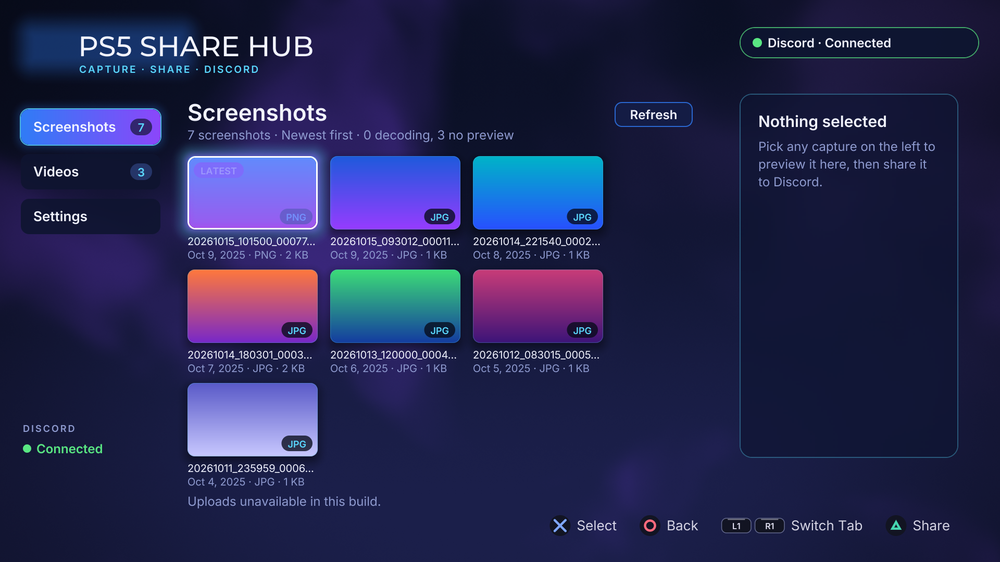

# PS5 Share Hub

A PS5 homebrew app that shows your captures in a controller-friendly gallery
and uploads them to Discord. Pick a screenshot or video, press Share, and it
lands in your channel.



## What it does

- **Screenshots and Videos tabs** — flat galleries, newest first, with a
  scrollable thumbnail grid. Photos decode to tiles; videos use the console's
  stored thumbnails with a play-tile fallback.
- **Video info page** — selecting a clip shows its thumbnail large plus its
  real length and resolution, parsed from the MP4 header, so you can confirm
  the right clip before sharing.
- **Share to Discord** — uploads the original file over TLS to your webhook,
  with progress on the Share button and a status line for each stage.
- **Settings tab** — enter your webhook URL with the on-screen keyboard
  (stored only on the console), see at a glance whether one is configured,
  and post a test message with **Test webhook**.
- **Media-area title** — installs into the PS5 Media section, with custom
  home-screen artwork.

No motion playback: the title runtime has no video decoder available, so
clips preview as thumbnails plus length/resolution.

## Install

Pick one:

- **Installer payload** (`ps5-share-installer.elf` on the release page):
  send it like any payload. It writes the app to `/data/homebrew` and
  tells you when it is done. Safe to run over an existing install; your
  saved webhook is kept.
- **By hand**: extract the release ZIP and copy the `PPSA99992` folder to
  `/data/homebrew` on the console (your saved webhook lives outside the
  app folder, so it survives).

Then launch PS5 Share from the Media section, open **Settings**, and add
your Discord webhook URL.

Get a webhook URL in Discord via Channel Settings → Integrations →
Webhooks → New Webhook → Copy Webhook URL.

## Build

Requires the PS5 payload SDK toolchain, fetched automatically on first
build. From WSL/Linux in the repo root:

```bash
make test-unit   # host unit tests (211 tests)
make             # folder build under dist/PPSA99992
```

The PS5 title build used here also links vendored `3p/ps5share` archives
(curl 8.22.0-DEV, mbedTLS 3.6.7) with the title's SceNet pool, DNS
resolver, and socket shims; see `tools/build.sh` for the exact link set.
`assets/webhooks.json` ships **empty** on purpose — every install adds its
own webhook in Settings.

## Credits and license

Renderer, components, and tooling: **ps5-homebrew-ui** by BlackBearReloaded,
GPL-3.0-or-later (this project included). Network stack: curl (MIT) and
mbedTLS (Apache-2.0 / GPL-2.0-or-later) — see `THIRD_PARTY_NOTICES.md`.
